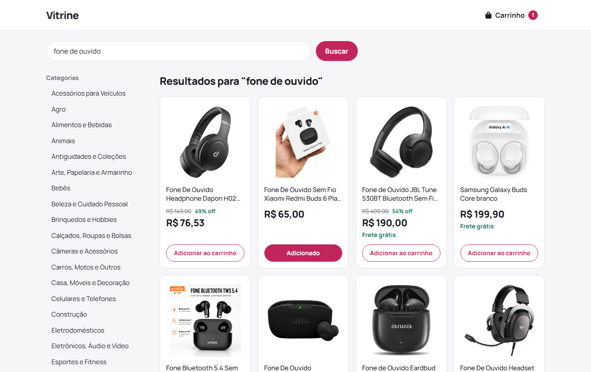
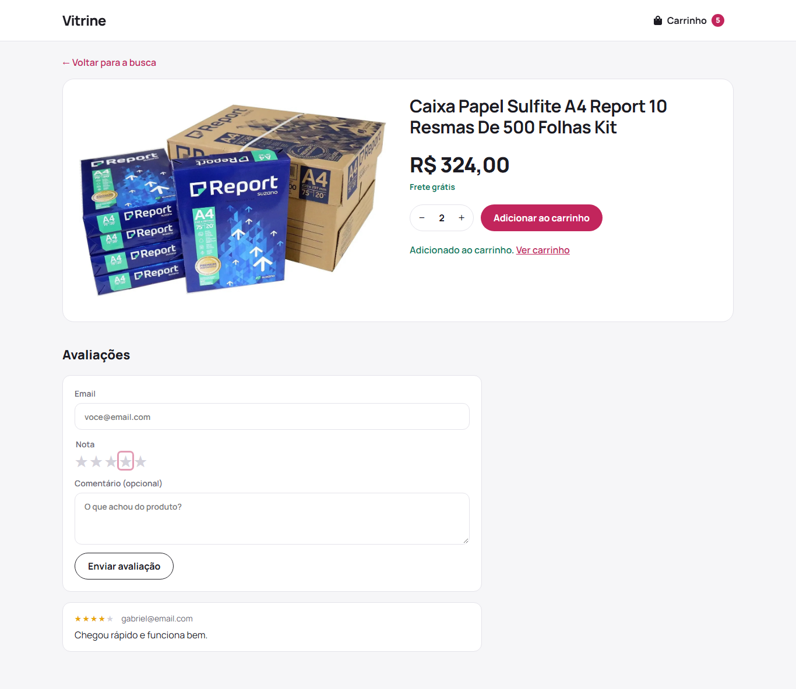
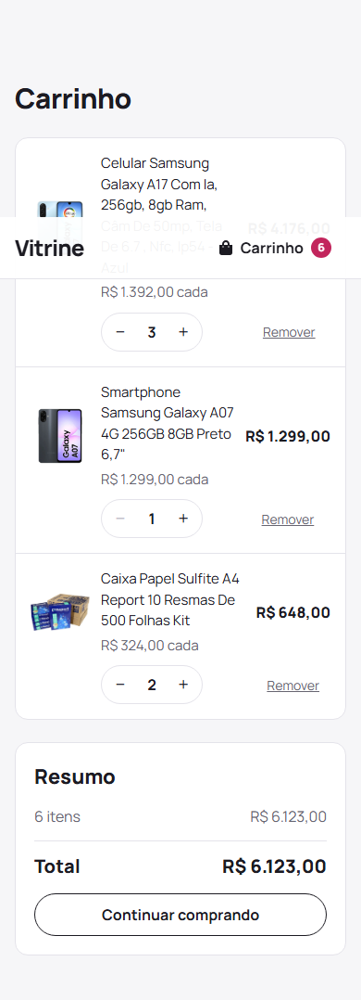

# Vitrine (Front-end Online Store)

An online store with real products from Mercado Livre, Brazil's largest marketplace: browse categories, search, open a product, leave a review and manage a cart, with prices in Brazilian reais.

**Live demo:** https://gabrielncorreia.github.io/frontend-online-store/



| Product page | Cart on a phone |
| --- | --- |
|  |  |

## Features

- Browse Mercado Livre's top-level categories, or search by text; each shows that category's best sellers
- Prices in BRL, with the original price, discount and free shipping when Mercado Livre has them
- Product page that also works from a shared link or after a reload
- Cart with quantities, per-line and overall totals, and removal, saved in the browser
- Reviews with a 1 to 5 star rating and an optional comment, stored per product in the browser only; nothing is published to Mercado Livre
- Category list that turns into a scrollable row of chips on phones

## How it gets the data

Mercado Livre's public listing search now refuses requests without a token, and a token cannot live in a static site. The app calls a small Cloudflare Worker, [mercado-livre-proxy](https://github.com/gabrielncorreia/mercado-livre-proxy), which holds the credentials, talks to Mercado Livre's catalog API and returns only what the store needs.

The proxy only answers the two apps. On the first request, the store passes an invisible Cloudflare Turnstile check and trades it for a 30-minute session token, sent with every request after that (`src/services/session.js`). A visitor sees the Turnstile box only if Cloudflare needs a click.

## Stack

React with Hooks and the Context API for the cart, React Router, and the proxy above.

## About the project

Built as a group project at [Trybe](https://www.betrybe.com/), working in agile sprints with Kanban and Scrum.

In 2026 I moved it to the proxy after Mercado Livre closed its public search, redesigned the interface and fixed bugs: the product page crashed when opened directly, the cart stored a duplicate entry per unit instead of a quantity, "Remove" did nothing, the total ignored quantity changes, and reviews were shared across every product.

## Running locally

Requires Node.js and the proxy running locally (see its README), which serves on `http://localhost:8799` by default. From the project folder:

```sh
npm install
npm start     # app at http://localhost:3000
npm test      # cart logic tests
```

To build against another proxy, set `REACT_APP_PROXY_URL` to its URL. `REACT_APP_TURNSTILE_SITE_KEY` overrides the Turnstile site key; development uses Cloudflare's test key, which the local proxy accepts.
